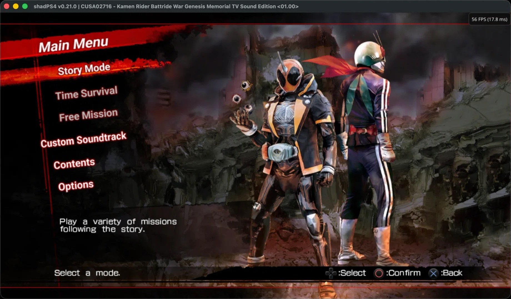
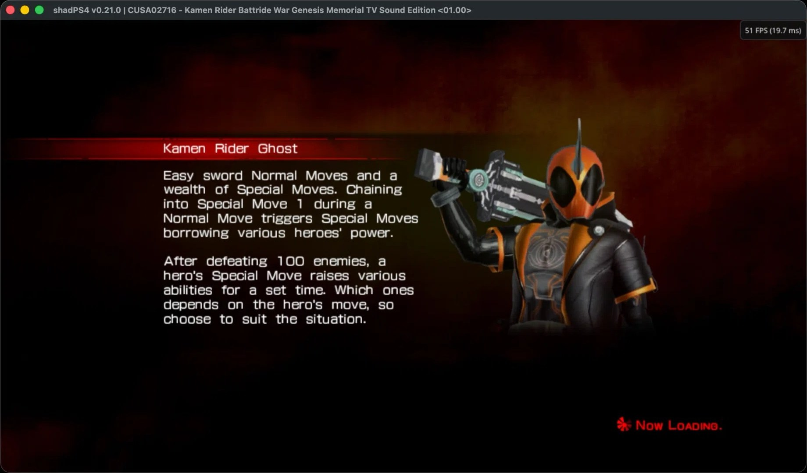
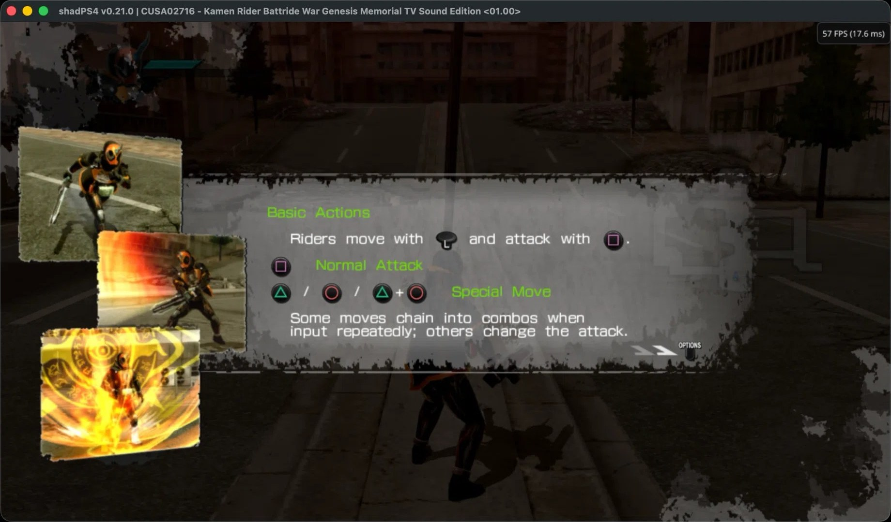
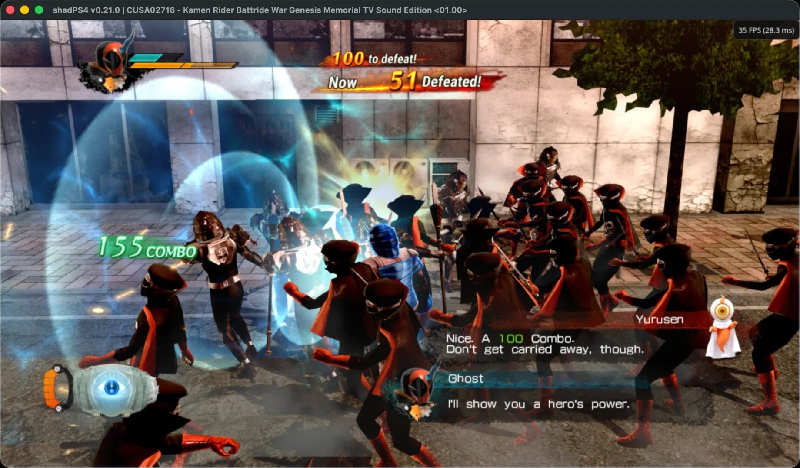
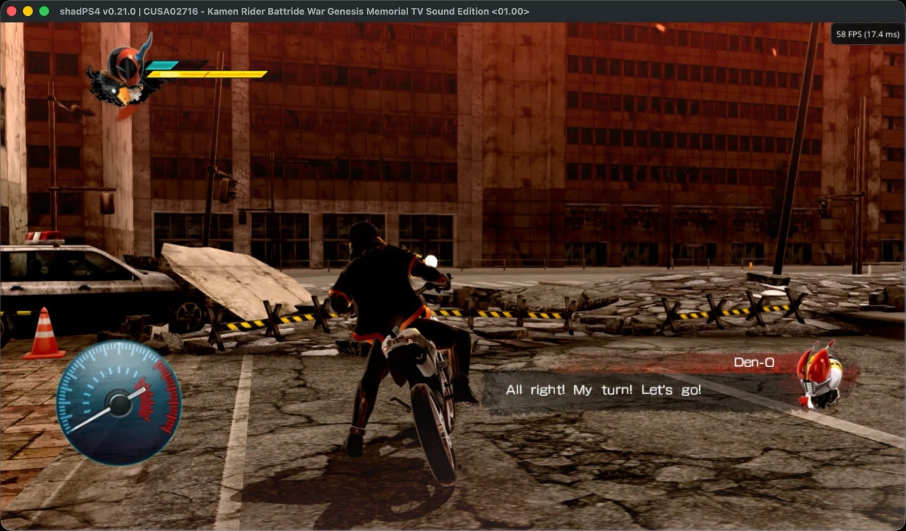

<p align="center"></p>

<h1 align="center">Kamen Rider Battride War Genesis: English patch</h1>

<p align="center">
  <b>An unofficial Japanese-to-English fan translation of the PS4 game (CUSA02716), for the shadPS4 emulator.</b>
</p>

<p align="center">
  <a href="https://github.com/vrieza/kamen-rider-battride-war-genesis-english-patch/releases/latest"></a>
  <a href="#how-to-apply"></a>
  <a href="https://github.com/vrieza/kamen-rider-battride-war-genesis-english-patch/issues/new"></a>
</p>

<p align="center">
  <b><a href="https://github.com/vrieza/kamen-rider-battride-war-genesis-english-patch/releases">Releases</a></b> &middot;
  <a href="CHANGELOG.md">Changelog</a> &middot;
  <a href="#whats-translated">What's translated</a> &middot;
  <a href="#known-issues">Known issues</a> &middot;
  <a href="https://github.com/vrieza/kamen-rider-battride-war-genesis-english-patch/issues">Issues</a>
</p>

> **v1.0.0.** The maintainer played this version in game on shadPS4 0.21.0: menus, missions, the DLC riders and 60 fps worked.
> Not every screen has been checked, so some text may overflow its box or break at the wrong place.

> **Game version: there are two downloads, one per app version.** Pick the one that matches your dump:
> - `battride-war-genesis-english-v1.0.0.zip` for **app v01.00** (the disc/base version).
> - `battride-war-genesis-english-v1.0.0-v102.zip` for **app v01.02** (the official update, cumulative, includes 01.01; adds three DLC riders).
>
> Each apply script checks every original file and refuses the other version, writing nothing.

> **v01.02 and the DLC riders.** The three riders the update adds (Chaser, Ghost Toucon Boost, Specter) are paid DLC. Their text (about 700
> lines) is translated. Each kit has an optional `extras/dlc` folder that unlocks all DLC on shadPS4 without a DLC dump (see [Optional extras](#optional-extras)).
> The maintainer played the DLC riders in missions with it and it worked.

The patch turns the Japanese game's text into English: menus, names, story mode, items, shop, figures and battle voice lines, plus 179 redrawn
textures. It needs your own copy of the game: nothing of the game is in this repository or in its releases, only binary patches against the
files of your own dump.

It is made for the **shadPS4** emulator and for a dump you made yourself from a disc or purchase you own. It is not for jailbroken consoles and
must not be used for piracy. Do not ask for game files, and do not share them in issues.

## Screenshots

Single frames from a patched build running in shadPS4 0.21.0 on macOS, not a full playthrough.

<table>
  <tr>
    <td></td>
    <td></td>
  </tr>
  <tr>
    <td align="center"><sub>Loading screen with the rider's description</sub></td>
    <td align="center"><sub>Tutorial: basic actions</sub></td>
  </tr>
  <tr>
    <td></td>
    <td></td>
  </tr>
  <tr>
    <td align="center"><sub>Mission: redrawn HUD labels and partner banter</sub></td>
    <td align="center"><sub>Mission: in-mission dialogue</sub></td>
  </tr>
</table>

## Status

Release 1.0.0, 2026-11-21:

- All text of v0.1 to v0.4 is translated and has had a second, full edit pass against the Japanese (see [how it was made](#how-it-was-made)).
- Credits and music lists are a first draft: some name readings are unsure.
- 27,836 of 28,258 text cells (98.5%) are edit-passed. The other 422 are the credits and music draft.
- 179 textures are redrawn in English. The glossary of fixed names and terms has 1,046 entries.
- The maintainer played the English in game on shadPS4 0.21.0 (menus, missions, the DLC riders). Nobody has checked every screen.

| Version | What | State |
|---|---|---|
| v0.1 | Menus, system text, names and labels | Translated, edit-passed, in this release |
| v0.2 | Story mode: mission info, briefings, in-mission dialogue, cutscene text | Translated, edit-passed, in this release |
| v0.3 | Items, skills, shop, figures, character info | Translated, edit-passed, in this release |
| v0.4 | Battle voice lines | Translated, edit-passed, in this release |
| Credits | Credits and music lists | First draft, edit pass not done (the draft is already in this release) |
| v0.4.2 | Text inside the game executable (`eboot.bin`): result screen, Rider Soul panel, confirm dialogs, HUD names | Translated, reviewed, in this release |
| v0.4.2-v102 | App v01.02: new and changed text for the three DLC riders, two redrawn menu images, three name plates | Translated, edit-passed, DLC riders played in game |

"Edit-passed" means read by a second AI pass against the Japanese. It does not mean checked in game.

**What's next:**

1. Edit pass of the credits and music lists.
2. Checks in the running game that need players: text box sizes, the encrypted tables, whether battle voice lines are read from the character
   archives, and the redrawn textures (see [Known issues](#known-issues)).
3. Not planned for now: the movies and the trophies.

## What's translated

| Area | State |
|---|---|
| Menus and system messages | Translated |
| Names and labels (riders, characters, forms, series, speakers) | Translated |
| Story mode: mission info, briefings, in-mission dialogue, cutscene text | Translated |
| Items, skills and the shop | Translated |
| Figures and character info | Translated |
| Battle voice lines (shouts and quips during missions) | Translated |
| 179 redrawn menu and HUD textures (labels baked into pictures) | Redrawn |
| Credits and music lists | First draft |
| Movies (their Japanese is part of the video) | Not translated |
| Text inside the game executable (`eboot.bin`) | Translated (481 strings; one more on v01.02) |
| Trophies | Not translated |

Names follow the official English spelling where one exists; the rest is romanized.

## How to apply

What you need: your own dump of the game (PS4 `CUSA02716`, Japanese, app version 01.00 or 01.02, unmodified), already **extracted into a folder** that
contains `nativeORBIS/` and `sce_sys/`. The patch does not extract the package for you; shadPS4 itself runs games only from an extracted
folder, so this is the same folder you already start the game from. A game that is already patched, another version or a repacked dump is refused.

1. Download the zip for your app version from [Releases](https://github.com/vrieza/kamen-rider-battride-war-genesis-english-patch/releases):
   `battride-war-genesis-english-v1.0.0.zip` (app v01.00) or `battride-war-genesis-english-v1.0.0-v102.zip` (app v01.02), and
   unzip it. It unpacks into one folder with the same name as the zip. Open a terminal and `cd` into it; steps 3 and 4 run from inside it.
2. Install Python 3.8 or newer. Nothing else is needed: no xdelta3, no extra packages. On macOS the `python3` that comes with the Command Line
   Tools works. Tested with Python 3.9, 3.12, 3.14 and 3.15 on macOS; Python 3.8 itself and Windows were not tested.
3. Optional check that the download is intact: `shasum -a 256 -c SHA256SUMS`. Every line should say `OK`.
4. Apply: `python3 apply_kit.py /path/to/CUSA02716` (the extracted game folder, not the folder you are in).
   - The script first checks the SHA-256 of every original file. If one differs it writes **nothing** and names the file.
   - Otherwise it writes the patched files into a new folder next to the game folder, named like the game folder plus `-mods`
     (here `/path/to/CUSA02716-mods`), and checks each result. It never writes into the game folder. `--out DIR` picks another folder.
   - Exit code 0 means every file was patched and verified.
   - The patches are plain VCDIFF files (still named `.xdelta`), so a stock xdelta3 can decode them too: `xdelta3 -d -s original patch output`.
5. Start the game in shadPS4 from the game folder as usual, for example `./shadps4 -g /path/to/CUSA02716`. shadPS4 reads the `-mods` folder as
   an overlay, but only when its name is exactly the game folder name plus `-mods`. If the game still shows Japanese, check that name.
6. To undo the patch, delete the `-mods` folder. The game folder is not touched.

Back up your save data first. It is shared with the Japanese game.

### shadPS4 notes

- Tested only with shadPS4 0.21.0 on macOS (Apple M4). Other versions may read the overlay folder differently.
- The game needs the PS4 firmware modules in shadPS4's `user/sys_modules/` folder (26 modules). Without them the game crashed in our tests, with
  or without this patch. You must supply them; the patch does not contain them.
- The English uses the game's own font. It has no accented letters or long dashes, so the text avoids them. The patch does not change the font.

Recommended settings (what we use, in shadPS4's `user/config.json`; not required by the patch):

| Section | Key | Value | Why |
|---|---|---|---|
| GPU | `present_mode` | `"Immediate"` | Less frame-pacing stall |
| GPU | `vblank_frequency` | `120` | Fewer frames held back to the next vblank |
| GPU | `rcas_enabled` | `false` | Saves GPU time |
| GPU | `fast_shader_math` | `true` | Saves GPU time |
| GPU | `internal_screen_width` / `internal_screen_height` | `1280` / `720` | Lighter load on our Apple M4 |
| General | `show_fps_counter` | `true` | Shows whether you are at 30 or 60 |

Back up `config.json` before editing it. These values were tuned on one Mac only.

## Optional extras

Each zip has an `extras/` folder. Both extras are optional and hold no game data.

### 60 fps

The game runs at 30 fps. The extra changes one number in `nativeORBIS/system/sysConf.boot` (30.0 to 60.0). Apply it with the same script:

```
python3 apply_kit.py /path/to/CUSA02716 --60fps
```

Tested in game by the maintainer on shadPS4 0.21.0 (Apple M4). It needs a machine that can run the game at 60. An early test build in 2026-11-12 saw enemies fail to spawn at 60 fps in missions; the maintainer's test of 1.0.0 did not, but if a mission stalls, run the script again without `--60fps`.

### Unlock the DLC (shadPS4)

The three DLC riders, the Hongo bonus and the figure packs are locked without the DLC. `extras/dlc/` holds a `param.sfo` and an empty placeholder file for each of the nine add-ons, which is what shadPS4 needs to treat them as owned.

1. Find the user folder your shadPS4 uses (it holds `addcont/`, `home/` and `log/`). Quit shadPS4.
2. Copy `extras/dlc/addcont/` into it. You get `<user folder>/addcont/CUSA02714/0000000000000000/` to `.../0000000000000008/` (the folder is `CUSA02714`, not `CUSA02716`).
3. Start the game fresh and press O through the unlock popups. Keep all files in place.

Tested in game by the maintainer on app v01.02: the popups, the roster entries and the DLC riders in missions. Labels `0000000000000002` and `0000000000000005` use guessed ids (the two figure packs with no public id). Full steps are in `install.md` inside the zip.

## Known issues

- Not every screen has been checked in game. The maintainer played menus, missions and the DLC riders.
- Text box sizes were never measured. Long names and lines may run past the box, be cut off or overlap.
- Some text tables are encrypted in the game files. English that is longer than the Japanese has never been seen in game in those tables.
- Battle voice lines may still show Japanese if the game reads other copies of those lines stored in the character archives.
- Apart from the early test build's one button and three HUD labels, the 179 redrawn textures have never been seen in game. The vertical
  objective captions and the two Rider Road banner halves are the riskiest.
- Movies and trophies stay Japanese.
- Executable text: only part of the 481 strings was seen on screen (result screen, HUD Shift Car and form names). Use shadPS4 directly; an
  emulator profile launched through ES-DE crashed about 2 minutes in, with or without this patch.
- App v01.02: saves made on v01.02 may not load on v01.00.
- Credits and music lists are a first draft. About 60 credit lines have unsure name readings.
- Some descriptions address the player as "you" and some do not; the style is not unified yet. A few descriptions lack the blank line between paragraphs.

## How it was made

Every English line was drafted by AI language models (Anthropic Claude) and then read again against the Japanese by a second AI edit pass. The
tools, the glossary and the texture redraws were also made with AI agents, directed by the human maintainer. No human has proofread the whole
text, and no human has played through it. Mistakes in meaning, tone and names are therefore possible, and corrections are welcome.

## Report a problem

[Open an issue](https://github.com/vrieza/kamen-rider-battride-war-genesis-english-patch/issues/new) in this repository. Please give:

- a screenshot,
- where in the game it is (which menu or mission),
- what the text should say,
- the version label: `v1.0.0` or `v1.0.0-v102`.

Never attach game files.

## Licences and credits

| What | Licence |
|---|---|
| The apply script and this README | MIT, see [LICENSE](LICENSE) |
| The translation text and the redrawn labels inside the patches | CC BY-NC-SA 4.0, see [LICENSE-translation-CC-BY-NC-SA-4.0.txt](LICENSE-translation-CC-BY-NC-SA-4.0.txt) |
| Redrawn labels' font (Roboto) | SIL Open Font License 1.1, Copyright 2011 The Roboto Project Authors |

Patch data is distributed as a fan translation; no rights to the game content are claimed or granted. The game, its names and its artwork
belong to their owners. This project is not affiliated with or endorsed by them. The game's own font is not changed.
